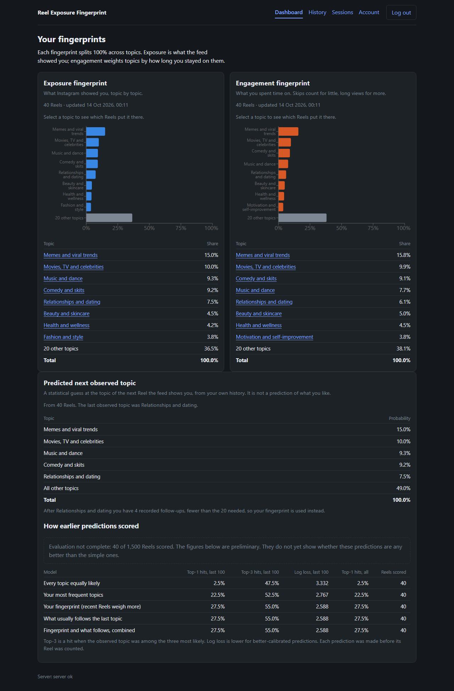
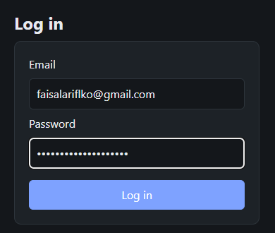
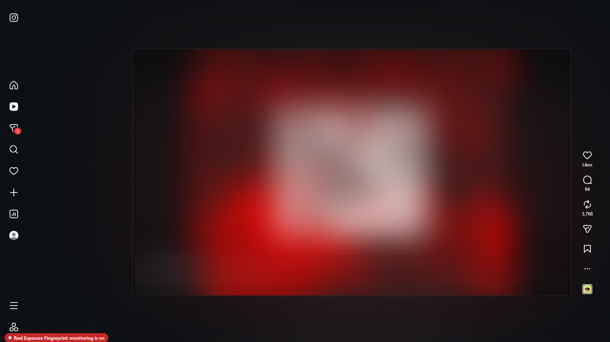
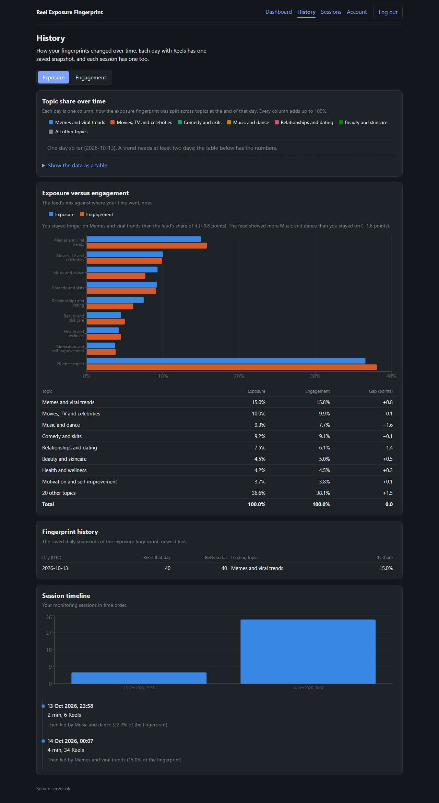
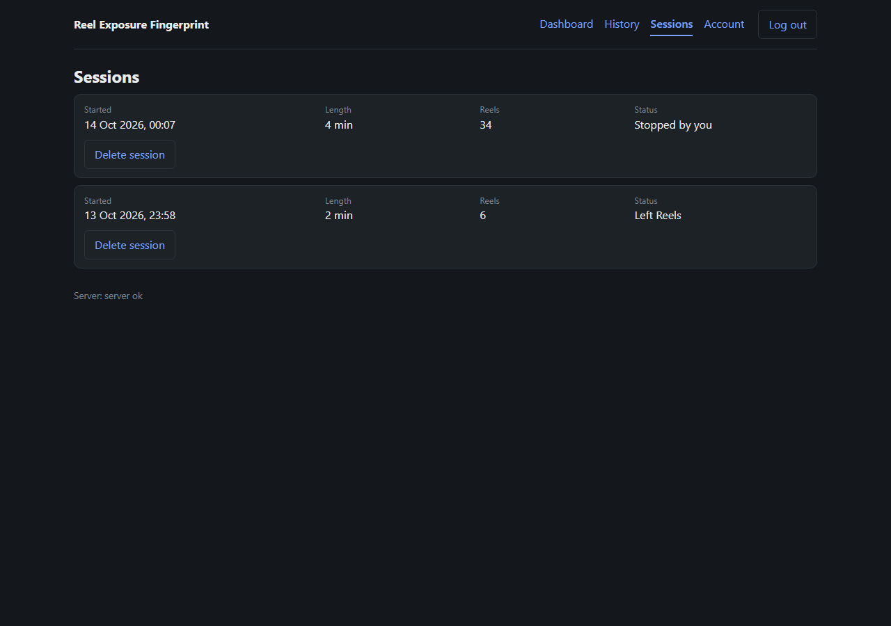

# Reel Exposure Fingerprint

**What does your Reels feed say about you: your taste, or Instagram's model of you?**

Reel Exposure Fingerprint is a research tool that turns the Instagram Reels you watch into two topic profiles:

- **Exposure fingerprint**: what the feed *showed* you.
- **Engagement fingerprint**: what you actually *stayed on*, weighted by dwell time.

The gap between the two is the interesting part. It shows where the recommender's picture of you and your own attention disagree.



## Why I built it

A recommender feed is not a mirror of your interests. It is the output of a ranking model. If you measure only what you were shown, you are measuring the model. If you measure only what you liked, you miss most of what shaped your attention.

I wanted a way to look at both, on my own account, with my own consent, without scraping or touching Instagram's private APIs. The result is a small, self-hosted system that:

- observes only what the page already renders in your own browser;
- keeps everything on your machine;
- lets you delete all of it in one click.

## How it works

```
Chrome extension (Manifest V3)
  content script   detects the Reel on screen, caption, hashtags, dwell time
  service worker   session rules, local queue, upload with retry
  popup            consent, token, start / stop
        |  HTTPS + bearer token, batched events
FastAPI  ->  PostgreSQL 16 + pgvector  (data and the job queue)
Worker   ->  text embedding (multilingual-e5-small)
         ->  zero-shot topic scores over a 28-topic taxonomy (English + Hindi descriptions)
         ->  late fusion -> exposure + engagement fingerprints (time-decayed, 7 day half-life)
         ->  next-topic prediction, compared with simple baselines
React dashboard: fingerprints, history, sessions, per-topic evidence, prediction
```

Design choices worth knowing:

- **Topic distributions, not a single vector.** Each Reel gets a probability over a fixed taxonomy. Fingerprints are weighted sums of those, so they stay interpretable and comparable across days.
- **Late fusion.** Text and image models live in different embedding spaces. Each scores against the same taxonomy and the *probabilities* are combined.
- **Reproducible.** Every result carries a `pipeline_version` hash of the models, taxonomy and parameters. A rebuild from stored assignments reproduces stored snapshots exactly.
- **Prediction is shown with baselines.** Next-topic prediction is only meaningful if it beats "most frequent topic", so the dashboard shows both and says when there is not enough data.

## Screenshots

| Login | Monitoring badge on Instagram |
|---|---|
|  |  |

| Exposure vs engagement over time | Sessions |
|---|---|
|  |  |

The Instagram screenshot is blurred. The badge in the lower left is shown on the page whenever the extension is collecting.

## Quick start

Requirements: Docker Desktop, Node.js 24, Google Chrome. Everything binds to `127.0.0.1`.

**1. Start the stack**

```bash
cp .env.example .env          # set POSTGRES_PASSWORD to a strong value
docker compose up -d --build
curl http://127.0.0.1:8000/healthz     # {"status":"ok"}
```

This starts the database, the API (it applies migrations on start), the worker and the dashboard at http://127.0.0.1:8080.

The first worker run downloads the text model (about 470 MB) into a Docker volume.

**2. Create your user and an extension token**

There is no sign-up page. Use an invite and the API (PowerShell shown; the same calls work with `curl`):

```powershell
$invite = (docker compose exec -T api python -m app.manage create-invite).Trim()
$api = "http://127.0.0.1:8000/api/v1"
$csrf = @{ "X-Requested-With" = "ref-dashboard" }
$email = "you@example.com"
$password = "choose-a-long-password"

Invoke-RestMethod -Method Post "$api/auth/register" -Headers $csrf -ContentType "application/json" `
  -Body (@{ email = $email; password = $password; invite_code = $invite } | ConvertTo-Json)
Invoke-RestMethod -Method Post "$api/auth/login" -Headers $csrf -ContentType "application/json" `
  -Body (@{ email = $email; password = $password } | ConvertTo-Json) -SessionVariable web
$t = Invoke-RestMethod -Method Post "$api/extension-tokens" -Headers $csrf -ContentType "application/json" `
  -Body (@{ label = "my chrome" } | ConvertTo-Json) -WebSession $web
$t.token | Set-Clipboard      # shown once; the server keeps only its hash
```

**3. Build and load the extension**

```bash
cd extension
npm ci
npm run build
```

In Chrome: `chrome://extensions` → turn on **Developer mode** → **Load unpacked** → select `extension/dist`.

**4. Collect**

1. Open the extension popup, paste the token, read and accept the consent screen.
2. Press **Start**, open `https://www.instagram.com/reels/` and scroll as you normally would.
3. A badge reading "monitoring is on" shows on the page while data is collected.
4. Press **Stop**. A session also ends if you leave the Reels page for 60 seconds, close the tab, or reach 60 minutes.

**5. Look at the result**

Open http://127.0.0.1:8080 and log in. The worker processes events within seconds (about 1.5 s per Reel on a laptop CPU, text only). Then:

- **Dashboard**: both fingerprints and the next-topic prediction.
- **History**: topic share over time, exposure versus engagement, session timeline.
- **Sessions**: your sessions, each with a delete button.
- **Account**: delete all your data.

## What gets collected, and what does not

Collected, only on `instagram.com/reels/*` and only during a session you started: Reel shortcode, creator handle, caption, hashtags, time observed, dwell time, video duration.

Never collected or done:

- Instagram credentials, cookies or tokens.
- Instagram network responses or private endpoints.
- Auto-scrolling, auto-playing or any simulated input.
- Anything without active consent, checked in the extension and again on the server.

Deleting a session or all data removes the database rows, derived data and any stored frames, and the server verifies zero rows remain before it answers. Raw media is never kept longer than 24 hours.

## Develop and test

Server (Python 3.12, [uv](https://docs.astral.sh/uv/)):

```bash
cd server
uv sync
uv run ruff check . ../tests
uv run mypy app
docker run -d --name ref-test-db -e POSTGRES_PASSWORD=pw -e POSTGRES_DB=ref_test \
  -p 127.0.0.1:55432:5432 pgvector/pgvector:pg16
TEST_DATABASE_URL=postgresql+psycopg://postgres:pw@127.0.0.1:55432/ref_test uv run pytest
```

Database tests are skipped when `TEST_DATABASE_URL` is unset. Tests that load real models need `REF_TEST_MODEL=1` and `uv sync --group ml`.

Extension and dashboard (Node 24):

```bash
cd extension   # or dashboard
npm ci
npm run lint && npm run typecheck && npm test && npm run build
```

Run the worker outside Docker: `cd server && uv sync --group ml && uv run python -m app.worker`.

CI (`.github/workflows/ci.yml`) runs all of the above.

## Project layout

```
extension/   Chrome MV3 extension (all Instagram selectors live in src/ig-adapter.ts)
server/      FastAPI app, Alembic migrations, worker (app/worker), fingerprint and prediction engines
dashboard/   React + Vite dashboard
taxonomy/    versioned topic taxonomy (English and Hindi descriptions)
tests/       pytest suite for the server
spikes/      throwaway feasibility experiments
docs/        spec, roadmap, decision records, evaluation and security reports
```

Start with `docs/final-spec.md`, `docs/architecture-decisions.md` and `docs/project-status.md`. Working rules are in `CONTRIBUTING.md`.

## Status and honest limits

This is a research prototype, not a finished product.

- **Works end to end today:** consent, sessions, capture on live Instagram (34 of 34 Reels captured in a hand-counted run), ingest, text pipeline, fingerprints, history, prediction, deletion.
- **Text only.** Frame capture, OCR and image embeddings are built on the server side but not wired into the extension, so topics come from captions and hashtags.
- **Not evaluated yet.** The labelling, self-report and prediction evaluations are implemented (`docs/evaluation-report.md`) but have not been run on a real labelled set. Treat the topic scores as unvalidated. The prediction panel needs about 1,500 Reels per user before it can say anything.
- **Single user, local.** Hosted mode with TLS exists (`docs/deployment.md`) but has not been run against a real domain, and the security audit lists open medium and low findings (`docs/security-audit.md`).
- **Desktop web only.** The web feed may be ranked differently from the mobile app, and scrolling "for a study" is not natural scrolling.
- **Platform terms.** Automated collection is restricted by Meta's terms. This tool only reads what is rendered in your own session and is meant for your own account with consent. Do not use it on anyone else's account and do not redistribute collected content.

## Licence

No licence has been chosen yet. All rights reserved until one is added.
