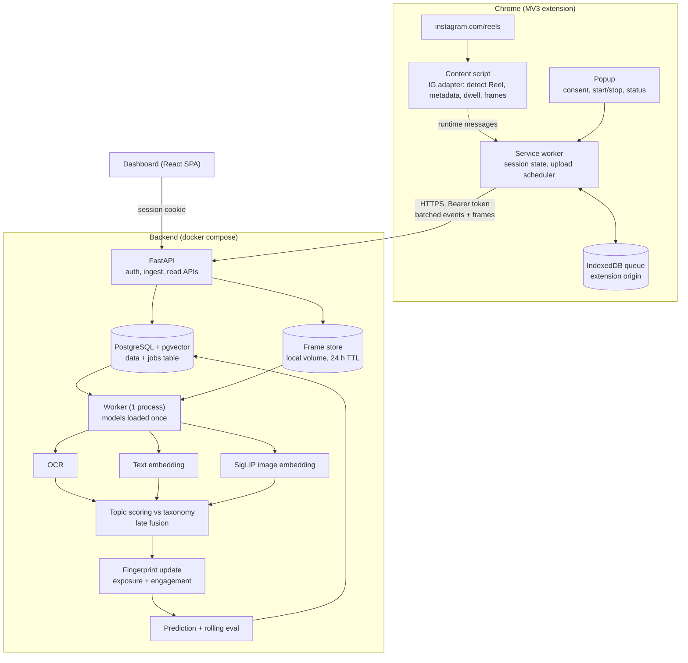

# Reel Exposure Fingerprint: Final Implementation Plan (MVP)

## 2. MVP scope

**In:** consent, manual session, Reel detection, metadata + caption + hashtags, dwell time, 3–5 frames per Reel, OCR, text + visual embeddings, taxonomy topic assignment, exposure and engagement fingerprints, daily snapshots, evidence view, next-topic prediction with baselines, deletion, retention.

**Out:** everything in 1.3, mobile, other browsers, likes/comments analysis, any automation of browsing.

**Definition of done:** a consenting user runs three or more sessions on separate days totalling 500+ Reels, the dashboard shows both fingerprints, their change over time, evidence per topic, and a prediction panel with accuracy against baselines; "delete all my data" leaves zero rows and zero files.

---

## 3. Functional requirements (MVP)

| ID | Requirement | Acceptance check |
|---|---|---|
| F1 | Explicit consent screen listing collected data, required before first session; revocable | With consent absent or revoked, extension emits zero events (verified in network log) |
| F2 | Manual start/stop of monitoring session; auto-stop on leaving Reels surface for >60 s, tab close, or 60 min cap | Session row has start, end, stop reason |
| F3 | Collect only on `https://www.instagram.com/reels/*` | Content script idle on all other paths |
| F4 | Detect primary visible Reel; one exposure per viewing instance | Scroll 50 Reels by hand: ≥95% detected, 0 duplicates |
| F5 | Capture shortcode, creator handle, caption, hashtags, observed_at, each with status `available` / `unavailable` | No field silently defaulted |
| F6 | Measure dwell: time as primary while tab visible and video playing | Dwell stops when tab hidden or video paused |
| F7 | Capture up to 5 downscaled frames per Reel, deduplicated | Median upload <250 KB per Reel |
| F8 | Local durable queue, batch upload, retry with backoff, idempotent by `event_id` | Kill network mid-session, restore: no loss, no duplicates |
| F9 | Backend pipeline: OCR, text embedding, visual embedding, topic distribution; any modality may fail independently | Reel with no caption still gets a topic from frames |
| F10 | Two fingerprints per user (exposure, engagement) as topic-weight vectors with time decay; snapshot per session and per day | Snapshots reproducible from stored assignments |
| F11 | Evidence: each topic lists the Reels that contributed, with scores | Click topic → list of Reels with link, caption, score |
| F12 | Next-topic prediction as a probability list, labelled "predicted next observed topic" | Shown with rolling accuracy vs baselines |
| F13 | Delete a session, or all data | Rows and files gone; verified by count query |
| F14 | Visible monitoring indicator (badge + in-page marker) | Always on while collecting |
| F15 | Raw frames deleted after feature extraction or after 24 h, whichever first | Cron verified; frame directory empty next day |

## 4. Non-functional requirements (realistic)

| ID | Requirement | Target |
|---|---|---|
| N1 | Detection latency | <500 ms from Reel becoming primary |
| N2 | Browser overhead | No dropped scroll frames; content-script work <5 ms per mutation batch; frame encode off the main path |
| N3 | Processing throughput on 4 vCPU, no GPU | ≥1 Reel per 3 s; a 200-Reel session processed within 10 min |
| N4 | Dashboard API | p95 <500 ms (reads precomputed snapshots) |
| N5 | Delivery | No event loss across browser restart or network drop, checked by test, not by SLO |
| N6 | Security | TLS when not on localhost; hashed tokens; server-side ownership check on every row; payload size limits; rate limit on ingest; no Instagram credentials or cookies ever read |
| N7 | Privacy | Consent gate, minimisation, 24 h raw-media retention, full deletion, per-user isolation |
| N8 | Maintainability | All Instagram selectors in one adapter file with a self-test that reports which selectors fail |
| N9 | Reproducibility | Every assignment and snapshot stores `pipeline_version` (models, taxonomy version, fusion weights, half-life) |
| N10 | Observability | Structured logs plus one `/stats/pipeline` endpoint: queue depth, failures per stage, latency per stage |
| N11 | Capacity | Sized for ≤5 users and ≤100k exposures. Beyond that is not an MVP concern |

---

## 5. High-level design



### 5.1 Data flow

1. User clicks Start. Service worker creates a session on the backend and tells the content script to observe.
2. Content script tracks `video` elements with `IntersectionObserver`; the one with ≥60% visibility is primary. URL shortcode is the Reel ID.
3. While primary: accumulate dwell, grab frames at 0.5 s, 2 s, 4 s, 7 s, 11 s (stop when the Reel is left), drop near-duplicates by perceptual hash.
4. When the Reel stops being primary (or on `pagehide`), one event is sent to the service worker and written to the queue.
5. Service worker uploads batches every 15 s or 10 events. Server upserts by `event_id` and enqueues a job.
6. Worker runs the pipeline, writes features and topic distribution, updates fingerprints and transition counts, deletes frames.
7. Dashboard reads snapshots.

### 5.2 Core algorithms

**Topic taxonomy.** 25–30 topics, each with 3–5 short descriptions in English and Hindi. Embedded once per encoder and cached. Versioned file in the repo.

**Per-modality scoring.** For modality *m* with embedding *e_m*:
`p_m(k) = softmax_k( cos(e_m, t_k^m) / τ_m )` where `t_k^m` is topic *k*'s embedding in that encoder's space. Text uses caption + hashtags + OCR text. Visual uses the mean of frame embeddings.

**Late fusion.** `p(k) = Σ_m w_m · p_m(k)`, weights renormalised over modalities that exist for that Reel. Start `w_text = 0.5, w_visual = 0.5`; tune on the label audit. If `max_k p(k)` is under a threshold, assign `other`.

**Fingerprint.** For each user and each kind:
`W_k ← W_k · 2^(−Δt / h) + g · p(k)`
- `Δt` = time since last update, `h` = half-life (start 7 days)
- exposure fingerprint: `g = 1`
- engagement fingerprint: `g = clip(dwell / max(duration, 5 s), 0.1, 2.0)`; a sub-1.5 s skip gets 0.1
- display value = `W_k / Σ W`

**Prediction.** Hybrid: `P_next = λ · P_fingerprint + (1 − λ) · P_transition(· | current topic)`, with add-one smoothing and backoff to the fingerprint when the row has fewer than 20 observations. λ tuned on past data.

---

## 6. Tech stack

| Layer | Choice | Reason |
|---|---|---|
| Extension | Manifest V3, TypeScript, Vite + CRXJS, `idb` | Typed messages, fast rebuild |
| API | Python 3.12, FastAPI, Pydantic v2, SQLAlchemy 2, Alembic | Same language as ML code |
| Database | PostgreSQL 16 + pgvector | One store for rows, vectors and jobs |
| Job queue | `jobs` table with `FOR UPDATE SKIP LOCKED` | No Redis or Celery to run; enough for this volume |
| Worker | One Python process, models held in memory | Simple; batch within the process |
| Text embedding | `intfloat/multilingual-e5-small` (384-d) | Multilingual, fast on CPU |
| Vision embedding | SigLIP 2 base (multilingual text tower); fallback `google/siglip-base-patch16-256-multilingual` | Zero-shot topic scoring from frames |
| OCR | RapidOCR (ONNX) first; EasyOCR if Devanagari quality is poor | CPU cost; decide on 50 real frames in M4 |
| Frame store | Local docker volume | Files live <24 h; object storage is pointless |
| Dashboard | Vite + React + TypeScript, TanStack Query, Recharts | Static SPA, no server rendering needed |
| Deploy | docker compose; Caddy for TLS when hosted | One command, one machine |
| Tests | pytest, Vitest, saved HTML fixtures of the Reels page | Selector regressions caught offline |

Verify exact model IDs and licences on Hugging Face at build time; names move.

---

## 7. Authentication and authorisation

- **Dashboard:** email + password (argon2id), httpOnly SameSite=Lax session cookie. Users created by invite code. No OAuth, no public signup.
- **Extension:** dashboard issues a random 32-byte token, shown once, stored as SHA-256 hash, sent as `Authorization: Bearer`. Kept in `chrome.storage.local`. Revocable per device.
- **Authorisation:** every query filters by `user_id` taken from the token or cookie, never from the request body.
- **Instagram:** the extension never reads cookies, tokens, passwords or network responses of instagram.com. Only rendered DOM and video pixels.
- **Local single-user mode:** same code, bound to `127.0.0.1`, one seeded user.

---

## 8. API (v1)

| Method | Path | Caller | Purpose |
|---|---|---|---|
| POST | `/api/v1/auth/login` | dashboard | Start session cookie |
| POST | `/api/v1/auth/logout` | dashboard | End it |
| POST | `/api/v1/extension-tokens` | dashboard | Issue extension token (returned once) |
| DELETE | `/api/v1/extension-tokens/{id}` | dashboard | Revoke |
| PUT | `/api/v1/consent` | extension | Record consent with policy version |
| DELETE | `/api/v1/consent` | either | Revoke; stops active sessions |
| POST | `/api/v1/sessions` | extension | Start monitoring session |
| PATCH | `/api/v1/sessions/{id}` | extension | Stop, with reason |
| POST | `/api/v1/events` | extension | Batch ≤50 events, idempotent on `event_id` |
| POST | `/api/v1/events/{event_id}/frames` | extension | Multipart, ≤5 JPEG, ≤150 KB each |
| GET | `/api/v1/sessions` | dashboard | List sessions |
| GET | `/api/v1/sessions/{id}/reels` | dashboard | Reels in a session with topics |
| GET | `/api/v1/fingerprint/current?kind=` | dashboard | `exposure` or `engagement` |
| GET | `/api/v1/fingerprint/history?kind=&bucket=` | dashboard | Snapshots by `day` or `session` |
| GET | `/api/v1/topics/{id}/evidence` | dashboard | Contributing Reels and scores |
| GET | `/api/v1/predictions/next` | dashboard | Distribution plus rolling accuracy per model |
| GET | `/api/v1/stats/pipeline` | dashboard | Queue depth, failures, latency |
| DELETE | `/api/v1/sessions/{id}` | dashboard | Delete session and derived data |
| DELETE | `/api/v1/me/data` | dashboard | Delete everything |
| GET | `/healthz` | ops | Liveness |

Event payload:

```json
{
  "event_id": "uuid-v4 generated in extension",
  "session_id": "uuid",
  "reel_shortcode": "Cabc123",
  "observed_at": "2026-10-06T18:24:11.120Z",
  "dwell_ms": 8420,
  "video_duration_ms": 15000,
  "creator_handle": {"value": "somecreator", "status": "available"},
  "caption": {"value": "text ...", "status": "available"},
  "hashtags": {"value": ["ai", "coding"], "status": "available"},
  "frame_count": 4,
  "adapter_version": "ig-web-2026.10.1"
}
```

Ingest rules: reject if consent missing, session not owned or not active, `observed_at` outside session window by more than 5 min, body over 256 KB, or frames not `image/jpeg`.

---

## 9. Database

```sql
CREATE EXTENSION IF NOT EXISTS vector;

CREATE TABLE users (
  id uuid PRIMARY KEY, email text UNIQUE NOT NULL, password_hash text NOT NULL,
  created_at timestamptz NOT NULL DEFAULT now()
);

CREATE TABLE extension_tokens (
  id uuid PRIMARY KEY, user_id uuid NOT NULL REFERENCES users ON DELETE CASCADE,
  token_sha256 bytea UNIQUE NOT NULL, label text,
  created_at timestamptz NOT NULL DEFAULT now(), revoked_at timestamptz
);

CREATE TABLE consents (
  user_id uuid PRIMARY KEY REFERENCES users ON DELETE CASCADE,
  policy_version text NOT NULL, granted_at timestamptz NOT NULL, revoked_at timestamptz
);

CREATE TABLE sessions (
  id uuid PRIMARY KEY, user_id uuid NOT NULL REFERENCES users ON DELETE CASCADE,
  started_at timestamptz NOT NULL, ended_at timestamptz,
  status text NOT NULL, stop_reason text
);

CREATE TABLE reel_exposures (
  event_id uuid PRIMARY KEY,
  session_id uuid NOT NULL REFERENCES sessions ON DELETE CASCADE,
  user_id uuid NOT NULL REFERENCES users ON DELETE CASCADE,
  reel_shortcode text NOT NULL, observed_at timestamptz NOT NULL,
  dwell_ms int, video_duration_ms int,
  creator_handle text, caption text, hashtags text[],
  field_status jsonb NOT NULL, adapter_version text NOT NULL,
  process_status text NOT NULL DEFAULT 'pending'
);
CREATE INDEX ON reel_exposures (user_id, observed_at);
CREATE INDEX ON reel_exposures (reel_shortcode);

-- keyed by Reel, not by event: the same Reel seen twice is analysed once
CREATE TABLE content_features (
  reel_shortcode text NOT NULL, pipeline_version text NOT NULL,
  ocr_text text, ocr_confidence real,
  text_embedding vector(384), visual_embedding vector(768),
  modalities text[] NOT NULL, created_at timestamptz NOT NULL DEFAULT now(),
  PRIMARY KEY (reel_shortcode, pipeline_version)
);

CREATE TABLE topics (
  id smallint PRIMARY KEY, slug text UNIQUE NOT NULL, label text NOT NULL,
  taxonomy_version text NOT NULL
);

CREATE TABLE topic_assignments (
  reel_shortcode text NOT NULL, pipeline_version text NOT NULL,
  topic_id smallint NOT NULL REFERENCES topics,
  p_text real, p_visual real, p_fused real NOT NULL,
  PRIMARY KEY (reel_shortcode, pipeline_version, topic_id)
);

CREATE TABLE fingerprint_snapshots (
  id bigserial PRIMARY KEY, user_id uuid NOT NULL REFERENCES users ON DELETE CASCADE,
  kind text NOT NULL,            -- exposure | engagement
  bucket text NOT NULL,          -- session | day
  taken_at timestamptz NOT NULL, session_id uuid,
  weights jsonb NOT NULL, n_reels int NOT NULL, pipeline_version text NOT NULL
);
CREATE INDEX ON fingerprint_snapshots (user_id, kind, taken_at);

CREATE TABLE topic_transitions (
  user_id uuid NOT NULL REFERENCES users ON DELETE CASCADE,
  from_topic smallint NOT NULL, to_topic smallint NOT NULL, n int NOT NULL DEFAULT 0,
  PRIMARY KEY (user_id, from_topic, to_topic)
);

CREATE TABLE predictions (
  id bigserial PRIMARY KEY, user_id uuid NOT NULL REFERENCES users ON DELETE CASCADE,
  made_before_event uuid NOT NULL, model text NOT NULL,
  distribution jsonb NOT NULL, actual_topic smallint, hit_top1 bool, hit_top3 bool
);

CREATE TABLE jobs (
  id bigserial PRIMARY KEY, kind text NOT NULL, payload jsonb NOT NULL,
  status text NOT NULL DEFAULT 'queued', attempts int NOT NULL DEFAULT 0,
  run_after timestamptz NOT NULL DEFAULT now(), last_error text
);
CREATE INDEX ON jobs (status, run_after);
```

Embedding width for `visual_embedding` depends on the SigLIP variant chosen; set it in the first migration after M0.

---

## 10. Evaluation (what makes this research, not a demo)

| Question | Method | Pass bar |
|---|---|---|
| Are topic labels correct? | Hand-label 200 Reels across users; compare to top-1 fused topic; also report text-only and visual-only | ≥70% top-1, ≥85% top-3. Below that, fix the taxonomy before building anything downstream |
| Does the fingerprint reflect the user? | Before showing the dashboard, user rates interest 1–5 per topic. Spearman correlation against each fingerprint | Report both. Expect engagement > exposure; if not, that is a finding too |
| Does prediction work? | Prequential: predict before each Reel, then update. Top-1, top-3, log loss | Hybrid must beat "user's most frequent topic" and decayed fingerprint. If it does not, say so |
| Is the fingerprint stable? | Replay events in shuffled-session order and with half-life 3/7/14 days | Rank order of top 5 topics should not flip on small parameter changes |

Minimum data before any claim: 500 Reels per user for fingerprints, 1,500+ for transition-based prediction.

---

## 11. Milestones

Durations assume 15 h/week. Each milestone ends in something runnable.

### M0: Feasibility spikes and go/no-go (4–5 days)

Throwaway code. Answers decide the rest.

- [ ] On `instagram.com/reels/`, confirm URL shortcode changes per Reel and `IntersectionObserver` identifies the primary `video`.
- [ ] Frame grab test A: `drawImage(video)` to canvas, then `toBlob`. Check for tainted-canvas error.
- [ ] Frame grab test B: `chrome.tabs.captureVisibleTab` cropped to the video rect (limit ~2 calls/s, visible tab only).
- [ ] Confirm caption, handle, hashtags are reachable without class-name selectors.
- [ ] Run SigLIP + e5 + OCR on 20 saved frames on your machine; record seconds per Reel.
- [ ] Decide: self only, or cohort. If cohort, start ethics/consent paperwork now.

**Exit:** written one-page result. If neither frame method works, MVP becomes text-only and M4 shrinks to OCR-free. If Reel detection is unreliable, stop and rethink before writing more code.

### M1: Skeleton and auth (1 week)

- [ ] Monorepo: `extension/`, `server/`, `dashboard/`, `taxonomy/`, `docker-compose.yml`.
- [ ] Postgres + pgvector, Alembic migration for section 9.
- [ ] FastAPI: login, extension tokens, consent, sessions, `/healthz`.
- [ ] Extension shell: popup with consent screen, token paste, start/stop, badge indicator.
- [ ] CI: lint, type-check, pytest, Vitest.

**Exit:** start and stop a session from the popup; row appears in DB; unauthenticated calls return 401.

### M2: Observation and reliable ingest (1.5 weeks)

- [ ] `ig-adapter.ts`: primary-Reel detection, shortcode, handle, caption, hashtags, field status, selector self-test.
- [ ] Dwell tracking with visibility and pause handling.
- [ ] Queue in extension-origin IndexedDB; batch upload; exponential backoff; `pagehide` flush.
- [ ] `POST /events` with validation and idempotent upsert; job enqueued per new shortcode.
- [ ] Auto-stop rules (left surface, tab closed, 60 min cap).
- [ ] Saved-HTML fixtures and tests for the adapter.

**Exit:** scroll 100 Reels by hand; ≥95 exposures in DB, 0 duplicates; offline for 2 minutes mid-session loses nothing.

### M3: Text pipeline, first fingerprint, first dashboard (1.5 weeks)

- [ ] Taxonomy v1 (25–30 topics, bilingual descriptions), embedded and cached.
- [ ] Worker loop with `SKIP LOCKED`, retries, per-stage timing.
- [ ] Text normalisation (hashtag splitting, emoji strip, language-agnostic), e5 embedding, topic scoring.
- [ ] Exposure and engagement fingerprint update; session snapshot.
- [ ] Dashboard: login, current fingerprint (two bars side by side), session list.
- [ ] Start the 200-Reel hand-label set.

**Exit:** full vertical slice on text only. Label audit on text-only run recorded as the baseline number.

### M4: Frames, OCR, visual embedding, fusion (2 weeks)

- [ ] Frame capture using the method chosen in M0; schedule 0.5/2/4/7/11 s; downscale to 512 px short side, JPEG q70; dHash dedupe.
- [ ] `POST /events/{id}/frames`; frame store with TTL sweeper.
- [ ] OCR on at most 2 frames per Reel; keep text above confidence threshold.
- [ ] SigLIP image embeddings, mean-pooled; visual topic scoring.
- [ ] Late fusion with missing-modality renormalisation; `other` threshold.
- [ ] Cache by `(reel_shortcode, pipeline_version)`.
- [ ] Re-run label audit: text-only vs visual-only vs fused; tune weights and τ.

**Exit:** fused top-1 ≥70% on the label set, or a documented reason and a taxonomy revision. Frames directory empty 24 h after a session.

### M5: Temporal view, evidence, deletion (1 week)

- [ ] Daily snapshot job; history endpoint.
- [ ] Dashboard: topic-share-over-time chart, exposure vs engagement gap view, evidence drawer per topic.
- [ ] Deletion endpoints with cascade and file removal; consent revoke stops sessions.
- [ ] Replay script: rebuild all fingerprints from stored assignments for a given `pipeline_version`.

**Exit:** three sessions on three days show visible evolution; replay reproduces snapshots exactly; delete-all leaves zero rows and files.

### M6: Prediction and evaluation harness (1.5 weeks)

- [ ] Transition counts; models: uniform, most-frequent, decayed fingerprint, Markov with backoff, hybrid.
- [ ] Prequential logging into `predictions`; rolling top-1/top-3/log loss per model.
- [ ] Dashboard panel: next-topic distribution plus the accuracy table, baselines included.
- [ ] Self-report survey form (shown before first dashboard view) and correlation script.
- [ ] Sensitivity run on half-life.

**Exit:** evaluation table produced from real data. Result reported whichever way it falls.

### M7: Hardening and MVP release (1 week)

- [ ] Rate limits, payload caps, token revocation tested.
- [ ] `/stats/pipeline` and a failure view in the dashboard.
- [ ] Selector self-test surfaced in the popup ("adapter out of date" warning instead of silent bad data).
- [ ] One-command setup: `docker compose up`, seeded user, README, privacy notice text.
- [ ] Optional hosted mode: small VPS (4 vCPU / 8 GB), Caddy TLS, nightly `pg_dump`.
- [ ] Limitations section written: desktop-only sample, exposure is not preference, taxonomy bias, n of users.

**Exit = MVP done:** definition of done in section 2 met by at least one user other than the developer, or by the developer alone if ethics approval is not in place.

**Total: about 10 weeks.** If the deadline is shorter, cut in this order: M6 Markov/hybrid (keep baselines), OCR, hosted mode.

### After MVP (do not start earlier)

1. Audio: `video.captureStream()` or offscreen `tabCapture`, faster-whisper `small` int8, transcript joins the text branch.
2. Emerging topics: nightly HDBSCAN over stored text embeddings, human-named clusters proposed as taxonomy additions.
3. Explicit engagement signals: like/save/share clicks.
4. Sequence model, only above ~20k exposures.

---

## 12. Optimisations

| Area | Optimisation | Effect |
|---|---|---|
| Browser | Observe only `video` elements; debounce mutation handling; encode frames with `OffscreenCanvas` | No scroll jank |
| Browser | Stop frame capture when Reel is left; skip frames for dwell <1 s | Fewer uploads for skipped Reels |
| Network | Downscale + JPEG q70 + dHash dedupe; batch events | ~150–250 KB per Reel instead of MBs |
| Compute | Cache features by Reel shortcode across users and sessions | Repeat and viral Reels cost nothing |
| Compute | Precompute taxonomy embeddings; batch frames and texts per job pull | Higher throughput on CPU |
| Compute | ONNX / int8 for SigLIP and e5 if N3 is missed | Roughly 2× on CPU, check accuracy on the label set after |
| Compute | OCR only on the 2 sharpest frames | OCR is the slowest stage |
| Storage | Store embeddings and text, never raw media | Small DB, lower privacy exposure |
| Read path | Dashboard reads snapshots, not raw joins | Fast and stable charts |
| Ops | No vector index until >100k rows; exact search is fine | Less to tune |

---

## 13. Open decisions (owner: you)

1. Self-only or cohort? This sets the legal and ethics work, and whether hosted mode exists.
2. Deadline. Ten weeks at 15 h/week is the honest figure for this scope.
3. Is the research claim about exposure, engagement, or the gap between them? Pick before M3; it decides what the dashboard emphasises.
4. Taxonomy source: hand-written, or adapted from an existing content taxonomy. Needs settling in M3.
