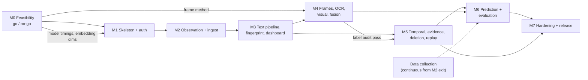

# Implementation Roadmap: Reel Exposure Fingerprint (MVP)

Source of truth: `docs/final-spec.md` (referred to below as "the spec", sections as §N).
This roadmap does **not** change the spec. Where the spec is ambiguous or self-contradictory, the issue is listed in §6 and a *proposed* resolution is recorded in `docs/architecture-decisions.md` with status **Proposed**. Nothing proposed takes effect until the owner accepts it.

---

## 1. Project summary

A Chrome MV3 extension passively observes the Reels a consenting user watches on `instagram.com/reels/*` during manually started sessions. Per Reel it records metadata, dwell time and up to 5 downscaled frames. A self-hosted backend (FastAPI + PostgreSQL/pgvector + one worker process) runs OCR, text and visual embeddings, assigns a distribution over a fixed bilingual (English/Hindi) taxonomy by late fusion, and maintains two time-decayed topic fingerprints per user:

- **Exposure**: what the feed showed (`g = 1`).
- **Engagement**: what the user dwelled on (`g = clip(dwell / max(duration, 5 s), 0.1, 2.0)`).

A React dashboard shows both fingerprints, their change over time, per-topic evidence, and a next-topic prediction panel scored against baselines. The research value is the evaluation in §10: label accuracy, fingerprint-vs-self-report correlation, prediction vs baselines, and stability.

---

## 2. Requirements inventory

### 2.1 Functional (§3)

| ID | Summary | Milestone | Verification |
|---|---|---|---|
| F1 | Consent screen, required before first session, revocable | M1 (UI), M5 (revoke stops sessions) | Network log shows zero events without consent |
| F2 | Manual start/stop; auto-stop: off Reels >60 s, tab close, 60 min cap | M1 (manual), M2 (auto) | Session row has start, end, stop_reason |
| F3 | Collect only on `https://www.instagram.com/reels/*` | M2 | Content script idle on other paths |
| F4 | Detect primary visible Reel, one exposure per viewing instance | M2 | 50 hand-scrolled Reels: ≥95% detected, 0 duplicates |
| F5 | Shortcode, handle, caption, hashtags, observed_at with `available`/`unavailable` status | M2 | No silent defaults |
| F6 | Dwell = primary + tab visible + video playing | M2 | Stops on hidden tab / pause |
| F7 | ≤5 downscaled, deduplicated frames per Reel | M4 | Median upload <250 KB per Reel |
| F8 | Durable local queue, batching, backoff, idempotent by `event_id` | M2 | Network kill/restore: no loss, no duplicates |
| F9 | OCR, text embedding, visual embedding, topic distribution; independent modality failure | M3 (text), M4 (rest) | Caption-less Reel still gets topic from frames |
| F10 | Exposure + engagement fingerprints, time decay, per-session and per-day snapshots | M3 (session), M5 (day) | Snapshots reproducible from stored assignments |
| F11 | Evidence per topic | M5 | Topic → Reels with link, caption, score |
| F12 | Next-topic prediction, labelled "predicted next observed topic" | M6 | Rolling accuracy vs baselines shown |
| F13 | Delete a session or all data | M5 | Count queries return zero; files gone |
| F14 | Visible monitoring indicator (badge + in-page marker) | M1 (badge), M2 (in-page marker) | Always on while collecting |
| F15 | Raw frames deleted after extraction or 24 h | M4 | Frame directory empty next day |

### 2.2 Non-functional (§4)

| ID | Target | Milestone | How verified |
|---|---|---|---|
| N1 | Detection <500 ms | M2 | Timestamped log in adapter test harness |
| N2 | No scroll jank; <5 ms per mutation batch; encode off main path | M2, M4 | Chrome Performance trace on a 50-Reel scroll |
| N3 | ≥1 Reel / 3 s on 4 vCPU; 200-Reel session in ≤10 min | M0 (estimate), M4 (measured) | Per-stage timings from worker |
| N4 | Dashboard p95 <500 ms | M5 | Load test on read endpoints |
| N5 | No event loss across browser restart or network drop | M2 | Automated test, not SLO |
| N6 | TLS off-localhost, hashed tokens, ownership checks, size limits, ingest rate limit, no IG credentials/cookies | M1 (auth), M7 (limits) | Tests per item |
| N7 | Consent gate, minimisation, 24 h media retention, full deletion, per-user isolation | M1, M4, M5 | Tests per item |
| N8 | All IG selectors in one adapter file + self-test | M2, M7 (popup warning) | Fixture tests |
| N9 | `pipeline_version` on every assignment and snapshot | M3 | Schema + replay test |
| N10 | Structured logs + `/stats/pipeline` | M3 (logs, timings), M7 (endpoint + view) | Endpoint returns depth/failures/latency |
| N11 | ≤5 users, ≤100k exposures | All | No action beyond not over-engineering |

### 2.3 Research / evaluation requirements (§10)

| Question | Needs | Milestone |
|---|---|---|
| Label accuracy ≥70% top-1, ≥85% top-3 | 200 hand-labelled Reels; text-only, visual-only, fused runs | Start M3, gate at M4 exit |
| Fingerprint vs self-report | 1–5 interest rating per topic **before first dashboard view**; Spearman | See C-3 in §6: must exist before any dashboard is shown |
| Prediction vs baselines | Prequential log; top-1, top-3, log loss; ≥1,500 Reels per user | M6 |
| Stability | Shuffled-session replay; half-life 3/7/14 days; top-5 rank stability | M5 (replay), M6 (sensitivity) |

Minimum data: 500 Reels per user for fingerprint claims; 1,500+ for transition-based prediction claims.

---

## 3. Scope

### 3.1 In MVP (§2)

Consent; manual sessions with auto-stop; Reel detection; metadata, caption, hashtags; dwell; 3–5 frames per Reel; OCR; text and visual embeddings; taxonomy topic assignment with late fusion; exposure and engagement fingerprints; per-session and daily snapshots; evidence view; next-topic prediction with baselines; session and full deletion; 24 h raw-media retention; evaluation harness; docker compose deployment; optional hosted mode.

### 3.2 Explicitly out of MVP

From §2 and §11:

- Mobile apps / mobile web.
- Browsers other than Chrome.
- Likes / comments analysis; explicit engagement signals (like, save, share clicks).
- Any automation of browsing (auto-scroll, auto-play, scripted navigation).
- Audio capture / transcription (faster-whisper).
- Emerging-topic discovery (HDBSCAN clustering).
- Sequence models for prediction.
- OAuth, public signup.
- Redis / Celery / object storage / vector index.
- Scale beyond 5 users / 100k exposures.
- **"Everything in 1.3"**: section 1 is missing from `final-spec.md`, so this list is incomplete. See A-1.

### 3.3 Cuttable inside MVP if the deadline shrinks (§11, in order)

1. M6 Markov and hybrid models (keep uniform / most-frequent / decayed-fingerprint baselines).
2. OCR.
3. Hosted mode.

---

## 4. Milestone dependency graph

Hard dependencies:

| Downstream | Depends on | Why |
|---|---|---|
| Everything | M0 Reel-detection result | §11: unreliable detection means stop and rethink |
| M1 migration | M0 visual-model choice | `visual_embedding` width is fixed in the first migration (§9) |
| M4 frame capture | M0 frame-grab result | Method A, B, or text-only fallback |
| M4 OCR choice | 50 real frames | RapidOCR vs EasyOCR decided on Devanagari quality |
| M5 replay, M6 prequential | Deterministic per-user processing order | See C-5 |
| M5 dashboard history, M6 prediction | Fused topics trusted (M4 audit gate) | §10: "fix the taxonomy before building anything downstream" |
| M6 evaluation | ≥1,500 Reels per user | Calendar time, not engineering time; collection must begin at M2 exit |
| M6 survey correlation | Survey answered before the user sees any dashboard | See C-3 |
| M7 cohort release | Ethics/consent paperwork if cohort | Decision D-1, started at M0 |

---

## 5. Risky assumptions

Ranked by impact × likelihood.

| # | Assumption | Why risky | Mitigation / validation |
|---|---|---|---|
| R1 | Frames can be grabbed from Instagram's `<video>` | Videos are MSE/blob from Meta CDNs; canvas may be tainted (`SecurityError` on `toBlob`/`getImageData`) | M0 test A. Fallback test B (`captureVisibleTab`). Final fallback: text-only MVP (§11 M0 exit) |
| R2 | `captureVisibleTab` is usable with minimal permissions | Requires `activeTab` (needs user gesture per invocation) or `<all_urls>`; ~2 calls/s quota; captures overlays and UI chrome | M0 test B must record which permission was needed. `<all_urls>` conflicts with N7 minimisation (see A-9) |
| R3 | Primary Reel is reliably the `video` with ≥60% visibility and URL shortcode changes per Reel | IG DOM and SPA routing change without notice; preloaded/adjacent videos; shortcode may update late | M0 spike; N8 adapter + self-test; HTML fixtures |
| R4 | Caption, handle, hashtags reachable without class-name selectors | IG uses obfuscated classes; captions may be truncated ("… more") | M0; fall back to `unavailable` status, never default |
| R5 | CPU throughput meets N3 (≤3 s per Reel) | SigLIP + e5 + OCR on 4 vCPU; OCR is slowest | M0 timing on 20 frames; ONNX/int8; OCR only on 2 sharpest frames |
| R6 | Zero-shot taxonomy scoring reaches 70% top-1 | Zero-shot on short, bilingual, meme-heavy content is often weaker; "other" threshold interacts | Start label set in M3; text-only baseline early; taxonomy revision budgeted |
| R7 | Enough data accumulates in time | 1,500 Reels per user for prediction; 3+ days for DoD | Developer starts daily collection right after M2 exit |
| R8 | Instagram tolerates passive DOM/pixel observation | ToS / account-risk for the observing user; extension could be flagged | No automation, no network interception (already in spec); document in privacy notice and limitations |
| R9 | Dwell is a valid engagement proxy | Autoplay loops, user away from keyboard with tab visible | Spec caps `g` at 2.0 and the 60 min session cap; report as limitation |
| R10 | Shared feature cache across users is harmless | Breaks "zero rows" deletion and cross-user isolation if not designed carefully | See C-1 |
| R11 | MV3 service worker stays alive long enough | SW suspends after ~30 s idle; timers (15 s batch, 60 s off-surface) may not fire | Use `chrome.alarms` + content-script keepalive messages; persist all state in `chrome.storage`/IndexedDB |
| R12 | Model IDs and licences unchanged | §6 warns names move | Verify on Hugging Face in M0; pin revisions |

---

## 6. Contradictions, gaps and ambiguities in the spec

Each item has a matching proposed ADR in `architecture-decisions.md`. Severity: **C** = contradiction (spec cannot be satisfied as written), **G** = gap (needed but unspecified), **A** = ambiguity.

### Contradictions

- **C-1 Shared feature cache vs full deletion.** `content_features` and `topic_assignments` are keyed by `reel_shortcode` with no `user_id`, shared across users (§9, §12). F13 / DoD require "zero rows" after delete-all. Deleting a user's data either leaves these rows (violates DoD) or deletes rows another user still references (corrupts their data). → ADR-007.
- **C-2 `pipeline_version` mixes content and user parameters.** N9 puts half-life into `pipeline_version`, but `content_features` and `topic_assignments` are keyed by it. Changing half-life (required by §10 sensitivity runs) would invalidate the feature cache even though features do not depend on half-life, and visual features cannot be recomputed because frames are deleted after 24 h. → ADR-008.
- **C-3 Survey timing.** §10 requires the self-report survey *before the first dashboard view*. The dashboard ships in M3; the survey is scheduled in M6. The developer (and any early user) will have seen the dashboard months before the survey exists, contaminating the correlation. → ADR-016 (move survey to M3, before dashboard login lands).
- **C-4 Job enqueue granularity.** M2 says "job enqueued per new shortcode", but fingerprints, transitions and predictions must update for *every exposure*, including repeats of cached Reels. → ADR-010.
- **C-5 Incremental decay vs asynchronous processing.** The fingerprint update `W ← W·2^(−Δt/h) + g·p` and prequential prediction assume events are applied in `observed_at` order. Batched upload, retries, and frame-wait make processing order differ from observation order. Snapshots would not be reproducible (F10, M5 exit). → ADR-011.
- **C-6 Payload limit vs frame limit.** Ingest rejects bodies over 256 KB (§8), but the frames endpoint allows 5 × 150 KB = 750 KB. → ADR-013 (limits are per endpoint).
- **C-7 Session deletion vs aggregates.** `topic_transitions` are aggregate counts; `fingerprint_snapshots.session_id` and `predictions.made_before_event` have no foreign keys. Deleting one session cannot cleanly subtract its effect and leaves orphan rows. → ADR-012 (delete, then rebuild derived state by replay).

### Gaps

- **G-1 No current-fingerprint state table.** Snapshots are per session/day; the incremental formula needs persistent `W_k` and last-update time per user and kind. → ADR-011.
- **G-2 No table for survey responses or hand labels.** Both are central to §10. → ADR-016.
- **G-3 Invite codes have no table or endpoint** (§7). → ADR-004.
- **G-4 Frame/event readiness.** Frames upload after the event. Nothing says when the feature job may run, so the worker could process text-only and cache that result permanently for the shortcode. → ADR-010.
- **G-5 Frame transport from content script to service worker.** `chrome.runtime` messages are JSON-only; Blobs need encoding, and the content script's IndexedDB belongs to the instagram.com origin, not the extension origin required by §5. → ADR-002.
- **G-6 `video_duration_ms` has no field status**, but the engagement formula depends on it. → ADR-014.
- **G-7 Session `status` and `stop_reason` vocabularies undefined.** → ADR-014.
- **G-8 Transition "current topic" undefined**: argmax of `p_fused`, including or excluding `other`? Same for `actual_topic` in predictions. → ADR-015.
- **G-9 Day bucket timezone undefined** for daily snapshots. → ADR-014.
- **G-10 Jobs payloads and logs may contain user data** and are not covered by deletion. → ADR-012.
- **G-11 Rate limiter mechanism unspecified.** → ADR-005.

### Ambiguities

- **A-1 Section 1 is missing.** §2 says "Out: everything in 1.3". The out-of-scope list cannot be fully known. Owner must supply section 1 or confirm §3.2 above is complete.
- **A-2 URL patterns.** Instagram uses both `/reels/<code>/` and `/reel/<code>/`. F3 names only `/reels/*`. Also, SPA navigation from the home feed into Reels will not inject a content script that matches only `/reels/*`. F3's wording ("idle on all other paths") suggests the script is injected more widely but stays idle. M0 must confirm actual URLs.
- **A-3 Label-audit gate placement.** §10 says fix the taxonomy "before building anything downstream" if <70%; milestones build fingerprint and dashboard (M3) before the fused audit (M4 exit). Interpreted as: M3 proceeds on text-only, M5/M6 do not start until the M4 audit passes or a revision is documented.
- **A-4 "Predict before each Reel".** Prediction is made by the worker after the event exists. Interpreted as: computed from state strictly before the event in `observed_at` order (ADR-011).
- **A-5 "One exposure per viewing instance".** Scrolling back to a Reel already seen in the same session: new exposure or same? Interpreted as new exposure (new `event_id`), same feature cache.
- **A-6 Consent scope.** `consents` is per user; the extension is per device. Does granting on one device cover all devices? Interpreted as per user, with the extension also keeping a local gate (no events without a local consent flag).
- **A-7 `observed_at` meaning.** Time the Reel became primary, or time the event was emitted? Interpreted as became-primary time (needed for ordering and transitions).
- **A-8 Prediction cut.** If M6 Markov/hybrid are cut, F12 is satisfied by the decayed-fingerprint model only, labelled honestly.
- **A-9 Permissions.** Test B may require `<all_urls>`, contradicting minimisation. Decision depends on M0. → ADR-003.

---

## 7. Security and privacy requirements (consolidated)

| Area | Requirement | Source | Milestone |
|---|---|---|---|
| Consent | No session, event or frame without active consent, checked client-side **and** server-side | F1, §8 ingest rules | M1, M2 |
| Consent | Revoke stops active sessions immediately and halts uploads | §8 DELETE /consent | M5 |
| Consent | Consent records policy version | §8, §9 | M1 |
| Visibility | Badge + in-page marker always on while collecting | F14 | M1, M2 |
| Scope | Collect only on Reels surface; idle elsewhere | F3 | M2 |
| Instagram | Never read IG cookies, tokens, passwords, or network responses; only rendered DOM and video pixels | §7, N6 | All (code review gate) |
| Instagram | No browsing automation | §2 | All |
| Auth | Passwords argon2id; httpOnly SameSite=Lax cookie; invite-only users | §7 | M1 |
| Auth | Extension token: 32 random bytes, shown once, stored as SHA-256, revocable per device | §7 | M1 |
| Authorisation | `user_id` from token/cookie only, never body; ownership check on every row | §7, N6 | M1 onward (test per endpoint) |
| Transport | TLS when not on localhost (Caddy) | N6 | M7 |
| Input | Body ≤256 KB for JSON; frames JPEG only, ≤5, ≤150 KB each; batch ≤50 events; `observed_at` within session window ±5 min | §8 | M2, M4 |
| Abuse | Rate limit on ingest | N6 | M7 |
| CSRF | Cookie-authenticated mutating endpoints need CSRF defence beyond SameSite=Lax (e.g. custom header check) | Implied by N6 | M1 |
| CORS | API allows only dashboard origin (cookie) and extension origin (Bearer) | Implied | M1 |
| Minimisation | Store embeddings and text, never raw media long-term | §12 | M4 |
| Retention | Raw frames deleted after extraction or 24 h, whichever first | F15 | M4 |
| Deletion | Session delete and delete-all remove rows and files; verified by count query | F13 | M5 |
| Isolation | Per-user isolation, including shared feature cache handling | N7 | M5 (ADR-007) |
| Logs | Structured logs must not contain captions, OCR text, tokens or frame data | Implied by N7 | M3 |
| Backups | If hosted, nightly `pg_dump` must honour deletion (rotate and expire backups; document window) | Implied by F13 + M7 | M7 |
| Ethics | Cohort mode requires ethics/consent paperwork before any non-developer data | §11 M0, §13 | M0 decision |

---

## 8. Decisions that must be validated experimentally

| # | Decision | Experiment | Milestone | Decides |
|---|---|---|---|---|
| E1 | Reel detection approach | Hand-scroll on live IG; log shortcode changes and primary video | M0 | Go / no-go |
| E2 | Frame method A vs B vs none | Canvas `toBlob` taint test; `captureVisibleTab` crop test with permissions noted | M0 | ADR-003, M4 scope |
| E3 | Metadata selectors | Locate caption/handle/hashtags via structure, ARIA, links | M0 | Adapter design |
| E4 | Model choice and CPU timing | SigLIP 2 base vs siglip-base-patch16-256-multilingual; e5-small; RapidOCR on 20 frames | M0 | Visual dim in migration; N3 feasibility |
| E5 | OCR engine | RapidOCR vs EasyOCR on 50 real frames incl. Devanagari | M4 | OCR stage |
| E6 | Taxonomy quality | Text-only audit on 200 labels | M3 | Taxonomy v1 → v2 |
| E7 | Fusion weights, τ, `other` threshold | Text-only vs visual-only vs fused on label set | M4 | ADR-009 parameters |
| E8 | ONNX/int8 | Only if N3 missed; re-check label accuracy | M4 | Runtime |
| E9 | Half-life | Sensitivity 3/7/14 days; top-5 rank stability | M6 | Default h |
| E10 | λ and backoff threshold | Prequential tuning on past data | M6 | Hybrid parameters |
| E11 | Frame schedule and dedupe | Median bytes per Reel vs F7 (<250 KB) | M4 | Capture params |

---

## 9. Implementation roadmap

Durations from §11 (15 h/week). Each milestone ends in something runnable. Items marked **[ADR-x]** depend on a proposed decision being accepted.

### M0: Feasibility spikes and go/no-go (4–5 days)

Throwaway code in `spikes/` (not shipped).

1. Live IG: confirm URL patterns (`/reels/` vs `/reel/`), shortcode change timing, ≥60% `IntersectionObserver` primary detection, SPA navigation behaviour. (E1, A-2)
2. Frame test A: `drawImage(video)` → `toBlob`; record tainted-canvas error if any. (E2)
3. Frame test B: `captureVisibleTab` cropped to video rect; record required permissions and rate. (E2, A-9)
4. Metadata reachability without class names. (E3)
5. Verify model IDs, licences, output dimensions on Hugging Face; time SigLIP + e5 + RapidOCR on 20 frames on target-class CPU. (E4, R12)
6. Owner decisions D-1 (self vs cohort), D-2 (deadline); start ethics paperwork if cohort.
7. Owner supplies missing spec section 1 (A-1) and accepts/rejects proposed ADRs.

**Exit:** `docs/m0-feasibility.md` one-page result with go/no-go per item; chosen frame method; visual model + dimension; ADRs moved from Proposed to Accepted/Rejected.

### M1: Skeleton and auth (1 week)

1. Monorepo: `extension/`, `server/`, `dashboard/`, `taxonomy/`, `docker-compose.yml`.
2. Postgres 16 + pgvector; Alembic migration for §9 **plus** accepted schema additions (ADR-007, 008, 011, 014, 016, 004).
3. FastAPI: login/logout, invite-based user creation [ADR-004], extension tokens, consent, sessions, `/healthz`; ownership dependency used by every route; CSRF header check.
4. Extension shell: popup with consent screen, token paste, start/stop, badge indicator; local consent gate.
5. CI: ruff + mypy + pytest; eslint + tsc + Vitest.
6. Test: every endpoint returns 401 unauthenticated and 404 for other users' rows.

**Exit:** start/stop from popup creates/updates session row; unauthenticated calls 401.

### M2: Observation and reliable ingest (1.5 weeks)

1. `ig-adapter.ts`: single file for all selectors; primary detection; shortcode; handle; caption; hashtags; field status; self-test.
2. Dwell tracking (primary ∧ visible ∧ playing).
3. In-page monitoring marker (F14).
4. Extension-origin IndexedDB queue (service worker side) [ADR-002]; batch every 15 s or 10 events via `chrome.alarms`; exponential backoff; `pagehide` flush.
5. `POST /events`: validation, ingest rules, idempotent upsert, job enqueue per exposure [ADR-010].
6. Auto-stop: off-surface >60 s, tab close, 60 min cap; stop_reason vocabulary [ADR-014].
7. Saved-HTML fixtures and adapter tests; N1/N2 measurement.
8. Test: browser restart and 2-minute offline lose nothing (N5).

**Exit:** 100 hand-scrolled Reels → ≥95 exposures, 0 duplicates; offline 2 min loses nothing.
**From here, the developer collects data daily** (R7).

### M3: Text pipeline, first fingerprint, first dashboard (1.5 weeks)

1. Owner decisions D-3 (research claim) and D-4 (taxonomy source) before starting.
2. Taxonomy v1: 25–30 topics, 3–5 English + Hindi descriptions each, versioned file; embeddings cached per encoder.
3. Worker: `FOR UPDATE SKIP LOCKED`, retries with backoff, per-stage timing, structured logs without content.
4. Text normalisation; e5 embedding; text topic scoring.
5. Fingerprint state + update in `observed_at` order per user [ADR-011]; session snapshot.
6. **Self-report survey form and storage, gated before first dashboard view** [ADR-016].
7. Dashboard: login, survey gate, current fingerprints side by side, session list.
8. Label tool (minimal) and start the 200-Reel hand-label set [ADR-016].

**Exit:** text-only vertical slice; text-only label audit number recorded as baseline.

### M4: Frames, OCR, visual embedding, fusion (2 weeks)

1. Frame capture per M0 method; schedule 0.5/2/4/7/11 s; skip if dwell <1 s; 512 px short side; JPEG q70; dHash dedupe; encode off main thread.
2. `POST /events/{id}/frames` (multipart, per-endpoint limits [ADR-013]); frame store; TTL sweeper; delete after extraction.
3. Feature job waits for declared frames or timeout [ADR-010].
4. OCR (engine per E5) on 2 sharpest frames; confidence threshold.
5. SigLIP image embeddings, mean-pooled; visual scoring.
6. Late fusion with renormalisation; `other` threshold [ADR-009].
7. Cache by `(reel_shortcode, feature_version)` [ADR-008].
8. Label audit: text-only vs visual-only vs fused; tune weights, τ, threshold.
9. Measure N3; apply ONNX/int8 only if missed (E8).

**Exit:** fused top-1 ≥70% (or documented reason + taxonomy revision); frames directory empty 24 h after a session. **Gate:** M5 history and M6 prediction do not start until this exit is met (A-3).

### M5: Temporal view, evidence, deletion (1 week)

1. Daily snapshot job (timezone per ADR-014); history endpoint.
2. Dashboard: topic share over time; exposure vs engagement gap; evidence drawer.
3. Replay script: rebuild state, snapshots, transitions from stored assignments for a given version [ADR-011].
4. Deletion: session and all-data, cascade, file removal, jobs purge, shared-cache handling, rebuild after session delete [ADR-007, ADR-012]; consent revoke stops sessions.
5. Deletion test: count query over **every** table and the frame directory.
6. N4 check on read endpoints.

**Exit:** 3 sessions on 3 days show evolution; replay reproduces snapshots exactly; delete-all leaves zero rows and files.

### M6: Prediction and evaluation harness (1.5 weeks)

1. Transition counts [ADR-015]; models: uniform, most-frequent, decayed fingerprint, Markov with backoff, hybrid.
2. Prequential logging into `predictions`; rolling top-1/top-3/log loss per model.
3. Dashboard panel labelled "predicted next observed topic" with accuracy table incl. baselines.
4. Correlation script (Spearman, survey vs each fingerprint).
5. Sensitivity runs: half-life 3/7/14, shuffled-session order (E9); λ tuning (E10).

**Exit:** evaluation table from real data, reported whichever way it falls.

### M7: Hardening and MVP release (1 week)

1. Rate limit [ADR-005], payload caps, token revocation tests.
2. `/stats/pipeline` and dashboard failure view.
3. Selector self-test surfaced in popup ("adapter out of date").
4. `docker compose up` one-command setup, seeded user, README, privacy notice.
5. Optional hosted mode: 4 vCPU / 8 GB VPS, Caddy TLS, nightly `pg_dump` with retention policy.
6. Limitations section: desktop-only sample, exposure ≠ preference, taxonomy bias, n of users.

**Exit = MVP done:** §2 definition of done met.

**Total:** ~10 weeks engineering, plus calendar time for 1,500+ Reels per user before M6 claims.

---

## 10. Owner decisions required (§13 + this review)

| ID | Decision | Needed by |
|---|---|---|
| D-1 | Self-only or cohort | M0 |
| D-2 | Deadline | M0 |
| D-3 | Research claim: exposure, engagement, or gap | Before M3 |
| D-4 | Taxonomy source: hand-written or adapted | Start of M3 |
| D-5 | Supply missing spec section 1 (A-1) | M0 |
| D-6 | Accept / reject each Proposed ADR | M0 exit |
| D-7 | Acceptable extension permissions if frame method B needs `<all_urls>` | M0 exit |
